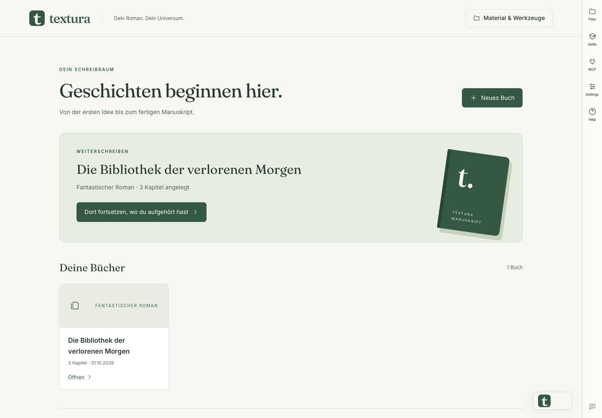
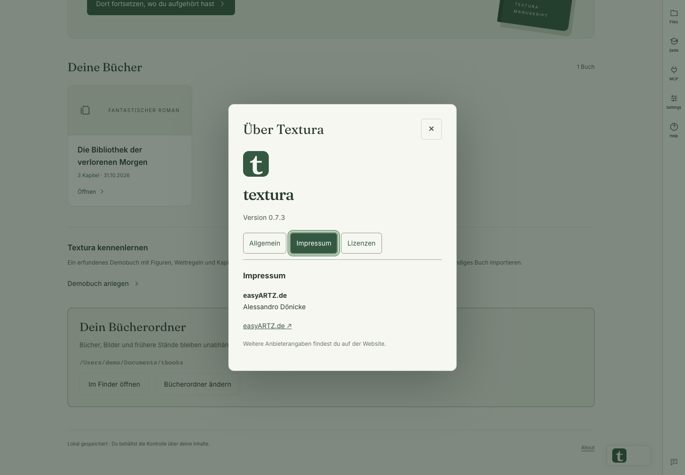
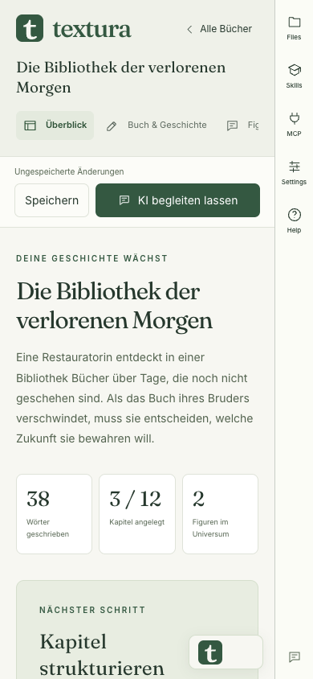
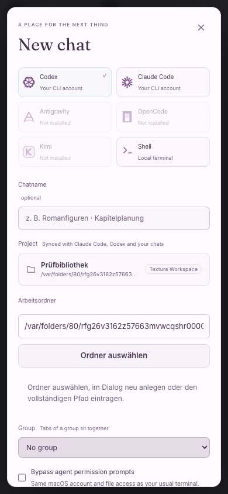

# Textura

**Dein Roman. Dein Universum.** Textura begleitet Autorinnen und Autoren von der ersten Idee bis zum fertigen Manuskript: Figuren, Beziehungen, Welt, Kapitel, Buchgedächtnis und optionale KI-Unterstützung an einem Ort.

## Textura 0.7.3 ansehen

Die Screenshots zeigen die Bedienoberfläche mit einem erfundenen Demobuch und einem neutralen Beispielpfad.

*Die Bibliothek öffnet zuletzt bearbeitete Bücher direkt und führt mit „Dort fortsetzen“ an den gespeicherten Arbeitsstand zurück.*

*Version, Impressum und Lizenzinformationen sind im About-Fenster gebündelt.*

*Das Romanstudio passt sich schmalen Fenstern an. Das Bild zeigt einen responsiven Browser-Test, keine native Smartphone-App.*

*Auch der KI-Chat wurde auf schmalen Fenstern geprüft.*

## Funktionen in 0.7.3

- Bibliothek mit direktem Einstieg in bereits geöffnete Bücher.
- Romanstudio für Buchidee, Figuren, Beziehungen, Universum, Einleitung und Kapitel.
- Lokal gespeichertes Buchgedächtnis, Revisionsstände und Medien.
- Bücher liegen unabhängig von der App standardmäßig unter `Dokumente/tbooks`; Ordner lassen sich mit Finder auswählen oder wechseln.
- KI-Chats können einen eigenen Arbeitsordner erhalten, ebenfalls über die native Ordnerauswahl.
- EPUB 3, DOCX, Markdown, TXT, JSON und druckbares HTML/PDF.
- Optional bestätigte KI-Unterstützung für Analyse, Lektorat, Illustrationen und Cover.
- About mit Version, Impressum und getrennten Open-Source-Lizenzhinweisen.
- Automatisierter UX-Prüfworkflow mit Kontrast-, Tastatur-, Layout- und PO-Freigabe.

Die Fortschrittsanzeige und KI-Analyse unterstützen die redaktionelle Arbeit; sie bescheinigen keine Verlagsreife. Komplexer Buchsatz und automatischer Vollimport beliebiger PDF-/DOCX-Ordner sind noch nicht enthalten.

## Herunterladen und installieren

[**Textura 0.7.3 für Apple Silicon laden**](https://github.com/sandrodoe/textura-releases/releases/tag/v0.7.3)

1. `Textura_0.7.3_aarch64.dmg` laden und öffnen.
2. `Textura.app` in den Ordner **Programme** ziehen.
3. Textura aus Programme starten.

Voraussetzung: Apple Silicon (M1 oder neuer), macOS 13.5 oder neuer. Der aktuelle Mac-Build ist ad hoc signiert, aber noch nicht von Apple notariell beglaubigt; macOS kann eine Sicherheitsbestätigung anzeigen. Windows-, Intel-Mac- und Linux-Installer sind in diesem Release nicht enthalten.

### Update von älteren Textura-Versionen

Bei Version 0.7.0 oder 0.7.1 Textura zuerst selbst beenden, Buchänderungen speichern und die aktuelle App manuell über die DMG ersetzen. Diese alten Versionen konnten den Installationsdialog nicht zuverlässig bestätigen. Ab 0.7.2 erfolgt die Bestätigung direkt in Textura. Bücher unter `Dokumente/tbooks` liegen außerhalb der App und bleiben beim Austausch erhalten.

## Automatische Updates

Textura prüft beim Start und alle sechs Stunden auf neue Releases. Das Updatearchiv wird vor dem Installieren kryptografisch geprüft. Die Installation und der Neustart beginnen erst nach deiner Bestätigung. Offene Änderungen und laufende KI-/Bildaufträge blockieren die Installation.

Der öffentliche Update-Feed ist [`latest.json`](https://github.com/sandrodoe/textura-releases/releases/latest/download/latest.json). Dateien `.tar.gz` und `.sig` sind für den eingebauten Updater. Für eine manuelle Installation die `.dmg` verwenden.

## Daten und Datenschutz

Das Repository stellt ausschließlich App-Installer und öffentliche Update-Metadaten bereit. Manuskripte, API-Schlüssel und private Signaturschlüssel werden nicht hier veröffentlicht. Bücher und zugehörige Bilder werden lokal gespeichert; den ganzen `tbooks`-Ordner sichern, wenn auch Revisionen und Medien gesichert werden sollen. Der JSON-Buchexport allein enthält keine separaten Bilddateien.

## Quellcode und Dokumentation

Der Quellcode bleibt privat: [sandrodoe/textura](https://github.com/sandrodoe/textura). Dort befinden sich README, vollständiges Handbuch, Build-Anleitung und UX-Prüfprozess. Dieses öffentliche Repository dient der Verteilung und den automatischen Updates.

Betreiberangaben: [easyARTZ.de – Alessandro Dönicke](https://easyartz.de).
